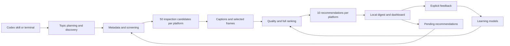

# Architecture

Deepvids has one Python engine.
The terminal, Codex skill, and local dashboard use that engine.
The Node launcher installs and starts the engine.
It does not implement recommendation logic.

## Project files

```text
deepvids/
  README.md                    Purpose and source installation
  LICENSE                      Deepvids license
  plugin.json                  Portable plugin identity
  .claude-plugin/
    marketplace.json           Existing compatibility catalog
  bin/
    deepvids.cjs                Node setup and process launcher
  skills/deepvids/
    SKILL.md                   Instructions for the Codex host
  src/deepvids/
    cli/                       Command arguments and dispatch
    discovery/                 Public searches and creator expansion
    exploration/               Topic hierarchy and query planning
    evidence/                  Captions, frames, transcription, and assessment
    recommendations/           Screening, ranking, batches, and reports
    learning/                  Feedback models and calibration
    web/                       Local server and browser assets
    data/queries.json          Curated search terms
    preferences.py             Profile and video actions
    identity.py               Platform, video, and part identities
    policy.py                 Default weights and duration rules
    parsing.py                Platform response parsing
    http.py                    Request limits and request records
    processes.py               Process deadlines and cleanup
    windows_job.py             Windows process ownership
    owned_process.py           Worker startup gate
    storage.py                Database, migrations, and exclusive locks
    readiness.py               Development readiness checks
    maintenance.py            Evidence cleanup
  python/
    evidence-requirements.txt   Locked media and browser dependencies
    asr-requirements.txt        Locked transcription dependencies
    *.whl                      Generated engine package, excluded from Git
  scripts/
    verify_package.py          Distribution checks
  tests/                       Automated tests
  docs/
    WORKFLOW.md                Recommendation steps
    ARCHITECTURE.md            This document
    SCORING.md                 Scoring and learning models
    REFERENCE.md               Commands and project maintenance
  .github/workflows/ci.yml      Automated repository checks
  pyproject.toml, uv.lock       Python package and dependency definitions
  package.json                 Node launcher and package file list
  package-lock.json            Locked Node development dependencies
```

`PROJECT_PLAN.md` contains internal implementation milestones.
Git ignores that file.
Public documents do not link to it.

## Processing flow



The web layer displays saved results and submits explicit user actions.
It does not contain a separate scoring algorithm.
The skill directs the host to call the engine.
It does not replace engine checks with model instructions.

## Module responsibilities

| Area | Main files | Responsibility |
| --- | --- | --- |
| Discovery | `queries.py`, `sources.py`, `state.py`, `service.py` | Build searches, parse results, and retain discovery progress |
| Exploration | `domains.py`, `proposals.py`, `planning.py` | Select existing topics and assess proposed topics |
| Evidence | `service.py`, `media.py`, `browser.py` | Resolve playable videos and collect bounded evidence |
| Evidence workers | `preparation_worker.py`, `asr_worker.py` | Separate media preparation and optional transcription processes |
| Assessment | `assessment.py`, `reports.py`, `retention.py` | Check model output, report evidence limits, and remove completed media |
| Recommendations | `service.py`, `batch.py`, `parallel.py`, `timing.py` | Coordinate platform jobs, worker limits, and recovery |
| Ranking | `engagement.py`, `metadata.py`, `originality.py`, `quality.py`, `ranking.py` | Screen candidates and select the final list |
| Learning | `features.py`, `inference.py`, `scoped.py`, `service.py` | Capture predictors, fit models, and calculate predictions |
| Feedback | `feedback.py`, `calibration.py`, `evaluation.py`, `evidence.py` | Store judgments, reserve test videos, and record evidence corrections |

File names in this table are relative to their area under `src/deepvids/`.

## Data storage

The engine resolves one external data directory for each command.
The installed package remains separate from this directory.
See [data directory selection](REFERENCE.md#choose-a-data-directory).

| Stored data | Purpose |
| --- | --- |
| `deepvids.sqlite3` | Jobs, request records, profile, video state, feedback, models, and calibration |
| `evidence/` | Captions, frames, scorecards, retained hashes, and unfinished media |
| `recommendations/` | Local Markdown digests and JSON reports |
| `runs/` | Discovery reports and request traces |
| `access/bilibili/profile/` | Separate browser profile for Bilibili sign-in |
| `runtimes/`, `wheels/` | External engine environments and cached wheels for the Node launcher |

SQLite schema 10 stores current ratings and the complete action history.
Topic anchors remain stable across rating edits and clears.
Model snapshots retain the identities of their training inputs.
Frozen evaluation records retain the tested model identity.

Database upgrades create a backup before they change an older schema.
Evidence corrections add derived records.
They do not overwrite original scorecards or user ratings.

## Concurrency and recovery

One batch coordinates both platforms.
The batch shares its time limit and worker limits.
It allows two preparation workers and up to four model workers.
Platform locks prevent conflicting recommendation jobs.
Short database transactions protect user actions and final result writes.

The engine checks profile, feedback, and queue changes before it saves a final recommendation list.
A conflicting change requires another ranking calculation.
An interrupted job retains its candidate position and remaining allowances.
Continuation does not reset those allowances.

Each worker belongs to an owned process group.
Windows uses a Job Object to stop the worker's child processes.
Cancellation checks prevent new work after the deadline.
The engine retains unfinished work when access or assessment fails.

## Evidence lifetime

The engine removes a downloaded full video after it checks the completed assessment.
It retains captions, frames, hashes, and scorecards for later use.
Unfinished jobs retain media for recovery.
Cleanup preserves user-supplied source files.

Optional transcription processes audio in chunks of at most ten minutes.
It releases each decoded buffer before the next chunk.
The transcription process releases its model when it exits.

## Installation boundary

The current source supports terminal execution and the local dashboard.
The repository contains a plugin manifest and a skill.
Actual Codex plugin installation still requires a host test.
Automatic daily scheduling is not implemented.

The intended plugin runs on the user's computer.
A future desktop schedule will invoke the same engine.
Package installation will not create a schedule automatically.
The current project does not provide a hosted dashboard or remote MCP service.
