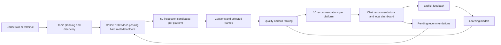

# Architecture

Broader Vids has one Python engine.
The terminal, Codex skill, and local dashboard use that engine.
The Node launcher installs and starts the engine.
It does not implement recommendation logic.

## Project files

```text
broader-vids/
  README.md                    Purpose and source installation
  LICENSE                      Broader Vids license
  plugin.json                  Portable plugin identity
  .agents/plugins/
    marketplace.json           Local Codex marketplace for the clean build
  bin/
    broader-vids.cjs            Node setup and process launcher
  skills/
    broader-vids/               Recommendations and feedback instructions
    broader-vids-setup/         Guided installation and profile selection
    broader-vids-dashboard/     Local dashboard access and shutdown
  src/broader_vids/
    cli/                       Command arguments and dispatch
    discovery/                 Public searches and creator expansion
    exploration/               Topic hierarchy and query planning
    evidence/                  Captions, frames, transcription, and assessment
    recommendations/           Screening, ranking, batches, and reports
    learning/                  Feedback models and calibration
    web/                       Local server and browser assets
    data/queries.json          Curated search terms
    preferences.py             Profile and video actions
    creators.py                Creator rules and immutable round snapshots
    blacklist.py               Authenticated Bilibili blacklist import
    identity.py               Platform, video, and part identities
    policy.py                 Default weights and duration rules
    parsing.py                Platform response parsing
    http.py                    Request limits and request records
    processes.py               Process deadlines and cleanup
    windows_job.py             Windows process ownership
    owned_process.py           Worker startup gate
    storage.py                Database, migrations, and exclusive locks
    readiness.py               Development readiness checks
    maintenance.py            Evidence cleanup
  python/
    evidence-requirements.txt   Locked media and browser dependencies
    asr-requirements.txt        Locked transcription dependencies
    *.whl                      Generated engine package, excluded from Git
  scripts/
    verify_package.py          Distribution checks
    build_plugin.py            Clean marketplace payload and plugin ZIP
  tests/                       Automated tests
  docs/
    WORKFLOW.md                Recommendation steps
    ARCHITECTURE.md            This document
    SCORING.md                 Scoring and learning models
    REFERENCE.md               Commands and project maintenance
  .github/workflows/ci.yml      Automated repository checks
  pyproject.toml, uv.lock       Python package and dependency definitions
  package.json                 Node launcher and package file list
  package-lock.json            Locked Node development dependencies
```

`PROJECT_PLAN.md` contains internal implementation milestones.
Git ignores that file.
Public documents do not link to it.

## Processing flow



The web layer displays saved results and submits explicit user actions.
It does not contain a separate scoring algorithm.
The skill directs the host to call the engine.
`worker_context.py` resolves the invoking thread's model and reasoning effort from local turn metadata.
New runs save that pair and pass it to planning and assessment CLI workers.
`recommendations/collection.py` continues candidate collection until 100 pass `screening.py` duration and raw engagement floors, or a saved limit stops collection.
The global top fifty metadata scores receive content assessment.
The final ten use the full ranking score.
Refill records retain query origins and anchors even when the discovery cache reaches its separate limit.
`recommendations/legacy.py` preserves screening rules for rounds created before screening policy 3.
Those rounds retain guaranteed pending slots, creator caps, and topic quotas.
Their discovery and final ranking also use the saved policy version.
It does not replace engine checks with model instructions.

## Dashboard files and state

The Python server serves local HTML, CSS, and JavaScript modules.
It permits only explicit static asset paths.
The dashboard uses native form controls and dialogs.

| File under `web/static/` | Responsibility |
| --- | --- |
| `index.html`, `dashboard.css` | Application shell, themes, and responsive layout |
| `dashboard.js` | Navigation, refresh coordination, and user actions |
| `state.js` | Server records, selections, scroll positions, and local drafts |
| `api.js` | Local requests, action tokens, and response errors |
| `views.js` | Compact video rows and exclusion management |
| `review.js` | Four independent rating groups and the creator checkbox |
| `score.js`, `ui.js` | Technical score presentation and shared controls |

Recommendations, exclusions, and calibration have separate views.
The desktop list and review panel scroll independently.
Narrow windows use a review dialog with Back navigation.
Score details use a separate desktop dialog or a secondary mobile view.

Saved records remain separate from drafts.
Video identity joins feedback across recommendations and calibration.
Each successful action updates its affected records.
Refresh requests carry a read version and a mutation generation.
The interface rejects responses from before a newer mutation.
It pauses background refresh while the tab is hidden or a write is active.
Refresh preserves active controls and pane positions.
Drafts survive navigation within the tab, but they require Save before the page closes.

## Module responsibilities

| Area | Main files | Responsibility |
| --- | --- | --- |
| Discovery | `queries.py`, `sources.py`, `state.py`, `service.py` | Build searches, parse results, and retain discovery progress |
| Exploration | `domains.py`, `proposals.py`, `planning.py` | Select existing topics and assess proposed topics |
| Evidence | `service.py`, `media.py`, `browser.py` | Resolve playable videos and collect bounded evidence |
| Evidence workers | `preparation_worker.py`, `asr_worker.py` | Separate media preparation and optional transcription processes |
| Assessment | `assessment.py`, `reports.py`, `retention.py` | Check model output, report evidence limits, and remove completed media |
| Recommendations | `service.py`, `batch.py`, `parallel.py`, `timing.py` | Coordinate platform jobs, worker limits, and recovery |
| Ranking | `engagement.py`, `metadata.py`, `originality.py`, `quality.py`, `ranking.py` | Screen candidates and select the final list |
| Learning | `features.py`, `inference.py`, `scoped.py`, `depth.py`, `service.py` | Capture predictors, fit models, and calculate predictions |
| Preference transfer | `learning/transfer.py`, `learning/posterior.py`, `learning/baseline.py`, `web/static/transfer.js` | Transfer learned parameters without video records |
| Feedback | `feedback.py`, `calibration.py`, `evaluation.py`, `evidence.py`, `annotations.py`, `migration.py` | Store judgments, reserve test videos, and record evidence corrections |

File names in this table are relative to their area under `src/broader_vids/`.

## Data storage

The engine resolves one external data directory for each command.
The installed package remains separate from this directory.
See [data directory selection](REFERENCE.md#choose-a-data-directory).

| Stored data | Purpose |
| --- | --- |
| `broader-vids.sqlite3` | Jobs, request records, profile, video state, feedback, models, and calibration |
| `evidence/` | Captions, frames, scorecards, retained hashes, and unfinished media |
| `recommendations/` | Local Markdown digests and JSON reports |
| `feedback/` | Local content descriptor records |
| `runs/` | Discovery reports and request traces |
| `access/bilibili/profile/` | Separate browser profile for Bilibili sign-in |
| `runtimes/`, `wheels/` | External engine environments and cached wheels for the Node launcher |

SQLite schema 12 stores current structured ratings and action records.
Migration replaces retired binary records with mapped ratings.
A private backup preserves recovery data.
The schema update removes active comment text and retires comment interpretation records.
Explicit tag rules reside in the user profile.
Creator rules reside in creator_exclusions.
Creator_policy stores their revision and active Bilibili account ID.
Creator_sync stores each account's import status and last successful sync.
Creator rules have a separate revision from the learning profile.
Round state stores a fixed creator-rule snapshot.
Public recommendation reports expose rule counts rather than imported creator IDs.
Topic anchors remain stable across rating edits and clears.
Model snapshots retain the identities of their training inputs.
Frozen evaluation records retain the tested model identity.

Preference transfer uses format 1 and learning model version 8.
It does not change SQLite schema 12.
A completed `preference_import` job stores the imported parameter baseline and local feedback cutoff.
Fitting combines that baseline with active ratings saved after the cutoff.
Historical ratings remain available to the dashboard.
Import holds both platform locks and the learning lock.
A short transaction checks the preview revision and commits the replacement atomically.
Parameter-only recovery files reside in `backups/`.
The dashboard uses authenticated local POST operations for export, preview, and import.
The transfer dialog preserves rating drafts and blocks stale polling responses during an operation.

Database upgrades create a backup before they change an older schema.
Evidence corrections add derived records.
They do not overwrite original scorecards or user ratings.

## Concurrency and recovery

One batch coordinates both platforms.
The batch shares its time limit and worker limits.
It allows two preparation workers and up to four model workers.
Preparation allows up to five minutes after its worker slot becomes available.
Assessment allows up to three minutes after its model slot becomes available.
Queue waits remain inside the parent time allowance.
They do not consume those separate stage allowances.
Metadata workers use separate database connections and a shared request gate.
The gate preserves request pacing and prevents concurrent reservation of the last request slot.
Platform locks prevent conflicting recommendation jobs.
Short database transactions protect user actions and final result writes.

The engine checks profile, feedback, and queue changes before it saves a final recommendation list.
A conflicting change requires another ranking calculation.
An interrupted job retains its candidate position and remaining allowances.
Continuation does not reset those allowances.

Each worker belongs to an owned process group.
Windows uses a Job Object to stop the worker's child processes.
Cancellation checks prevent new work after the deadline.
The engine retains unfinished work when access or assessment fails.
Candidate failures remain local to that candidate.
Platform access challenges and shared model failures stop the applicable workers.
Reports preserve the first failure separately from later cancellation messages.
Preparation checkpoints record transfer progress for interrupted-byte accounting.
Unknown usage retains an explicit upper bound.
Paused rounds can retain a provisional preview without creating exposure history.
Batch heartbeats and live elapsed calculations keep progress reports current.

## Evidence lifetime

The engine removes a downloaded full video after it checks the completed assessment.
It retains captions, frames, hashes, and scorecards for later use.
Unfinished jobs retain media for recovery.
Cleanup preserves user-supplied source files.

Optional transcription processes audio in chunks of at most ten minutes.
It releases each decoded buffer before the next chunk.
The transcription process releases its model when it exits.

## Installation boundary

The portable manifest declares recommendation, setup, and dashboard skills.
The repository marketplace points to a clean generated payload under `dist/`.
The npm archive and plugin ZIP carry the same engine and public assets.
The host installs a cache copy and does not need the working checkout's private files.
Guided setup installs an external runtime through the Node launcher.
The launcher's saved profile selection also applies to source commands.
Profile data remains separate from installed copies and their upgrades.
Automatic daily scheduling is not implemented.

Dashboard lifecycle operations use a per-profile operating-system lock.
They do not hold a database write transaction while stopping the server.
A private token and public instance identity authenticate shutdown and server reuse.
The loopback listener uses exclusive binding on Windows.
An occupied preferred port causes a free-port fallback.

The intended plugin runs on the user's computer.
A future desktop schedule will invoke the same engine.
Package installation will not create a schedule automatically.
The current project does not provide a hosted dashboard or remote MCP service.
