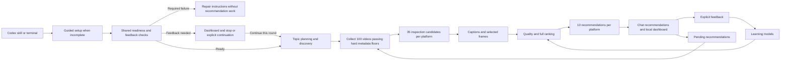

# Architecture

Broader Vids has one Python engine.
The terminal, Codex skill, and local dashboard use that engine.
The Node launcher installs and starts the engine.
Per-profile locks coordinate launcher commands and setup.
Ordinary commands can share the runtime. Setup requires exclusive access.
Active engine operations and dashboard servers block setup.
The launcher releases locks after normal completion or command failure.
A stale or unreadable lock blocks later work until the operator checks for surviving processes and repairs the lock.
The launcher has no stale-lock repair command and does not implement recommendation logic.

The GitHub marketplace and explicit npm installer both install the prepared npm plugin.
The npm installer registers a small host catalog without GitHub access or profile access.
Setup installs the bundled engine into external profile storage after plugin installation.

## Project files

```text
broader-vids/
  README.md                    Purpose, remote installation, and first use
  LICENSE                      Broader Vids license
  plugin.json                  Portable plugin identity
  .agents/plugins/
    marketplace.json           Remote catalog tracking the latest public npm release
  bin/
    broader-vids.cjs            Node setup and process launcher
    plugin-install.cjs         Explicit npm plugin registration through Codex
    runtime-lock.cjs            Shared runtime use and exclusive installation
    profile-data.cjs            Preview, reset, and complete data removal
  skills/
    broader-vids/               Recommendations and feedback instructions
    broader-vids-setup/         Guided installation and profile selection
    broader-vids-dashboard/     Local dashboard access and shutdown
    broader-vids-reset/         Fresh profile with tools and sign-in retained
    broader-vids-clean/         Complete local data removal
  src/broader_vids/
    cli/                       Command arguments and dispatch
    discovery/                 Public searches and creator expansion
    exploration/               Topic hierarchy and query planning
    evidence/                  Captions, frames, transcription, and assessment
      account_switch.py        Staged sign-in, verified replacement, and recovery
    recommendations/           Screening, ranking, batches, and reports
      retries.py               Shared candidate retry counts and cancellation recovery
    learning/                  Feedback models and calibration
    web/                       Local server and browser assets
    data/queries.json          Curated search terms
    onboarding.py              Atomic platform choice and setup completion
    preflight.py               Shared readiness and incomplete-feedback checks
    preflight_checks.py        Bounded tool and authenticated-access probes
    preferences.py             Profile and video actions
    creators.py                Creator rules and immutable round snapshots
    blacklist.py               Authenticated Bilibili blacklist import
    identity.py               Platform, video, and part identities
    policy.py                 Default weights and duration rules
    parsing.py                Platform response parsing
    http.py                    Request limits and request records
    processes.py               Process deadlines and cleanup
    time_budget.py             Optional round time limits and JSON representation
    windows_job.py             Windows process ownership
    owned_process.py           Worker startup gate
    storage.py                Schema 12 database and exclusive locks
    maintenance.py            Evidence cleanup
    token_usage.py             Durable model-attempt receipts and stage reports
  python/
    core-requirements.txt       Locked keyword-conversion dependency
    evidence-requirements.txt   Locked media and browser dependencies
    asr-requirements.txt        Locked transcription dependencies
    *.whl                      Generated engine package, excluded from Git
  scripts/
    release.py                 Build, verify, and synchronize release artifacts
    release_ci.py              Patch planning, publication checks, and GitHub assets
    versioning.py              Validated release metadata synchronization
    test.py                    Isolated parallel regression runner
    verify_package.py          Distribution checks
    build_plugin.py            Clean marketplace payload and plugin ZIP
  tests/                       Automated tests
  docs/
    WORKFLOW.md                Recommendation steps
    ARCHITECTURE.md            This document
    SCORING.md                 Scoring and learning models
    REFERENCE.md               Commands and project maintenance
  .github/workflows/ci.yml      Automated repository checks
  pyproject.toml, uv.lock       Python package and dependency definitions
  package.json                 Node launcher and package file list
  package-lock.json            Locked Node development dependencies
```

## Processing flow



The web layer displays saved results and submits explicit user actions.
It does not contain a separate scoring algorithm.
The skill directs the host to call the engine.
`worker_context.py` resolves the invoking thread's model and reasoning effort from local turn metadata.
New runs save that pair and pass it to planning and assessment CLI workers.
`recommendations/collection.py` continues candidate collection until 100 pass `screening.py` duration and raw engagement floors, or a saved limit stops collection.
Screening policy 5 combines metadata screening with learned interest and balances query coverage across thirty-five content-assessment slots.
Final selection favors distinct narrow topics and queries before it compares full scores.
`recommendations/diversity.py` implements these deterministic selection rules.
An insufficient range of assessed topics permits repeats and records the relaxation in each affected selection.
Each new round saves one learning-model reference for screening, preview, and final selection.
Resumed rounds retain their saved plan, policies, and remaining allowances.
Refill records retain query origins and anchors even when the discovery cache reaches its separate limit.

The recommendation collector uses `collection_policy.py` for retrieval groups and saved targets.
`collection_batches.py` scans bounded batches, fills group deficits, and preserves unfinished batch progress.
`collection.py` supplies targeted search continuations and resumes unfinished collection batches.
`budgets.py` defines request defaults and applies explicit request-cap increases under run and platform locks.
Request-cap changes update settings and add an audit event in one transaction.
They do not rewrite saved recommendation state or reset resource use.

## Dashboard files and state

The Python server serves local HTML, CSS, and JavaScript modules.
HTTP/1.1 connections reuse sockets for asset and API requests.
Idle connections wait at most one second for another request. Active requests use a thirty-second socket timeout.
Shutdown disconnects clients and waits for request handlers to close their database connections before closing the account controller.
The server rejects ambiguous request lengths and closes connections after error responses.
It permits only explicit static asset paths.
The dashboard uses native form controls and dialogs.

| File under `web/static/` | Responsibility |
| --- | --- |
| `index.html`, `dashboard.css` | Application shell, themes, and responsive layout |
| `dashboard.js` | Navigation, refresh coordination, and user actions |
| `state.js` | Server records, selections, scroll positions, and local drafts |
| `api.js` | Local requests, action tokens, and response errors |
| `token-usage.js` | Saved-round token reports and scoped dialog refresh |
| `bilibili-account.js` | Account-switch controls, scoped status polling, and cancellation |
| `views.js` | Compact video rows and exclusion management |
| `review.js` | Four independent rating groups and the creator checkbox |
| `score.js`, `ui.js` | Technical score presentation and shared controls |

Recommendations, exclusions, and calibration have separate views.
The desktop list and review panel scroll independently.
Narrow windows use a review dialog with Back navigation.
Score details use a separate desktop dialog or a secondary mobile view.

The dashboard uses one system font and shared text-size variables.
Page titles, section titles, headings, body text, controls, captions, and small metadata each have a defined size.
Buttons, action links, navigation, and form controls share the control size.
Compact buttons reduce padding without reducing their text size.
The Bilibili panel places its external management link in the header and groups local actions below the account fields.
An idle account switch has no explanatory status text.
Local GET requests have a thirty-second limit, and writes have a ninety-second limit.
Account polling permits one status read at a time and skips unchanged interface updates.
A failed account-switch state remains readable so its controls can recover.
HTTP failures and failed writes still display errors.

Saved records remain separate from drafts.
Video identity joins feedback across recommendations and calibration.
Each successful action updates its affected records.
Refresh requests carry a read version and a mutation generation.
Only one refresh group runs at a time.
A refresh requested during an active read waits until that read finishes.
Old video records stay in browser memory only while the server returns them, an earlier list uses them, or they have an unsaved rating draft.
The interface removes saved-status notes and inspector positions when their videos leave all retained lists and drafts.
The interface rejects responses from before a newer mutation.
It pauses background refresh while the tab is hidden or a write is active.
Refresh preserves active controls and pane positions.
Drafts survive navigation within the tab, but they require Save before the page closes.

The engine stores token usage as versioned `token_usage` events in the existing database.
Each attempt has one call ID. Later events update that attempt's known status and usage.
The report reads the last event for each call ID.
Parallel workers record the owning recommendation ID and the source evidence ID.
New rounds use exact owner receipts. Historical rounds use saved checkpoint usage where available.
A derived database index supports report queries without a schema-version change.
The ledger stores counters and identifiers, without copying prompts, frames, transcripts, or credentials.
Reports do not depend on recommendation publication or media files.
A missing measurement remains unknown after interruption.
Reset and Clean remove usage with recommendation history.
Preference import and export do not transfer usage history.

## Module responsibilities

| Area | Main files | Responsibility |
| --- | --- | --- |
| Discovery | `queries.py`, `languages.py`, `sources.py`, `state.py`, `service.py` | Build searches, check keyword scripts, parse results, and retain discovery progress |
| Exploration | `domains.py`, `coverage.py`, `rotation.py`, `proposals.py`, `planning.py` | Select underused leaf topics, coordinate reservations, and plan queries |
| Evidence | `service.py`, `media.py`, `downloader.py`, `captions.py`, `browser.py` | Resolve playable videos and collect bounded evidence |
| Evidence workers | `preparation_worker.py`, `asr_worker.py` | Separate media preparation and optional transcription processes |
| Assessment | `assessment.py`, `worker_instructions.txt`, `reports.py`, `retention.py` | Check model output, report evidence limits, and remove completed media |
| Recommendations | `service.py`, `batch.py`, `parallel.py`, `timing.py` | Coordinate platform jobs, worker limits, and recovery |
| Ranking | `engagement.py`, `metadata.py`, `originality.py`, `quality.py`, `ranking.py`, `diversity.py`, `personalization.py` | Screen candidates and select the final list |
| Learning | `features.py`, `topic_labels.py`, `inference.py`, `scoped.py`, `depth.py`, `service.py` | Capture predictors, fit models, and calculate predictions |
| Preference transfer | `learning/transfer.py`, `learning/posterior.py`, `learning/baseline.py`, `web/static/preferences.js` | Transfer learned parameters without video records |
| Feedback | `feedback.py`, `calibration.py`, `evaluation.py`, `evidence.py`, `annotations.py` | Store judgments, reserve test videos, and record evidence corrections |

File names in this table are relative to their area under `src/broader_vids/`.

## Data storage

The engine resolves one external data directory for each command.
The installed package remains separate from this directory.
See [data directory selection](REFERENCE.md#choose-a-data-directory).

| Stored data | Purpose |
| --- | --- |
| `.broader-vids-profile.json` | Profile ownership marker for safe lifecycle operations |
| `onboarding.json` | Versioned default platform and setup completion, separate from learned parameters |
| `broader-vids.sqlite3` | Jobs, request records, profile, video state, feedback, models, and calibration |
| `evidence/` | Captions, frames, scorecards, retained hashes, and unfinished media |
| `recommendations/` | Local Markdown digests and JSON reports |
| `feedback/` | Local content descriptor records |
| `runs/` | Discovery reports and request traces |
| `access/bilibili/profile/` | Separate browser profile for Bilibili sign-in |
| `runtimes/`, `wheels/` | External engine environments and cached wheels for the Node launcher |

Onboarding uses an atomic versioned file protected by a separate configuration lease.
It does not change SQLite schema 12 or the learning revision.
Preference transfer excludes this file.
Preflight counts unique recommendation exposures against current structured ratings.
Cleared fields count as incomplete again.
Its isolated subprocess checks have a deadline and owned process cleanup.
Bilibili checks use the existing browser profile without reading cookies into model inputs.
Account switching stages a fresh profile under `access/bilibili/switches/`.
A bounded worker owns the browser, blacklist, and Bilibili recommendation leases.
The dashboard polls its status without blocking navigation or rating drafts.
After verification, a file journal and database receipt coordinate session activation.
Recovery restores the previous files before a database commit or removes the old session after a commit.
Completed and cancelled workers remove their temporary profiles and staged blacklist database.
Failed cleanup retains the journal and blocks browser use until recovery succeeds.
New and resumed recommendation commands record automated-check time.
That time counts toward an explicit total allowance when one exists.

This release supports fresh empty databases (schema 0) and existing schema 12 profiles.
The engine rejects other database schemas without changing them.
Schema 12 stores current structured ratings and action records.
Explicit tag rules reside in the user profile.
Creator rules reside in creator_exclusions.
Creator_policy stores their revision and active Bilibili account ID.
Creator_sync stores each account's import status and last successful sync.
Creator rules have a separate revision from the learning profile.
Round state stores versioned creator-rule and learning-model references.
Public recommendation reports expose rule counts rather than imported creator IDs.
Topic anchors remain stable across rating edits and clears.
Model snapshots retain the identities of their training inputs.
Frozen evaluation records retain the tested model identity.

Preference transfer accepts format 4 with learning model version 8 and feature version 1.
Manual creator rules transfer separately from learning parameters and replace the manual lists transactionally on import.
The export omits account-specific blacklist copies and sign-in data.
It includes a bounded exploration summary with at most 1,024 nodes and aggregate counts and round ages.
It includes watched video IDs without titles, ratings, or recommendation records.
Import adds their watched state without clearing local video states.
It does not change SQLite schema 12.
A completed `preference_import` job stores the imported parameter baseline and local feedback cutoff.
Fitting combines that baseline with active ratings saved after the cutoff.
Historical ratings remain available to the dashboard.
Import holds both platform locks and the learning lock.
Import prepares the restored model before the write transaction.
A short transaction checks the preview revision and commits the replacement atomically.
Concurrent feedback remains available and prevents a stale import from committing.
Export reuses an exact cached model when available.
Input validation runs once per terminal or HTTP request.
Failed imports remove unused recovery files.
Import also removes obsolete model caches while preserving models referenced by recommendations or frozen evaluations.
An uncertain commit retains its recovery file.
Preference recovery files reside in `backups/` and include prior watched IDs and manual creator rules.
The dashboard uses authenticated local POST operations for export, preview, and import.
The transfer dialog preserves rating drafts and blocks stale polling responses during an operation.

Evidence corrections add derived records, including the current missing-caption deduction.
They do not overwrite original scorecards or user ratings.

The Preferences page uses `preferences.js` to coordinate `/api/interests` and the preference-transfer endpoints.
One controller serializes interest saves and file operations.
A successful import returns the saved profile and updates the editor without another page.
`tag_rules.py` combines manual tag exclusions with removable built-in defaults.
The profile stores disabled built-in tags separately from manual tags.
Preference imports preserve these local exclusion choices.
Tag saves update rules without fitting a learning model.
The dashboard serializes tag writes per platform and rejects older tag snapshots.
An interest save preserves a draft when only exclusion metadata changed.
Profile revisions prevent one window from replacing a newer interest edit.
Interest writes hold both platform locks and preserve learned parameters and historical video data.

## Concurrency and recovery

One batch coordinates both platforms.
The batch shares worker limits and an optional total time limit.
New rounds have no overall deadline by default.
The time policy keeps internal unlimited values out of saved JSON.
It allows four preparation workers in total, with at most two per platform.
It allows up to four model workers.
Prepared evidence bypasses the preparation queue.
Preparation allows up to five minutes after its worker slot becomes available.
Assessment allows up to three minutes after its model slot becomes available.
Queue waits count toward an explicit parent time allowance when one exists.
They do not consume those separate stage allowances.
Metadata workers use separate database connections, a shared cookie jar, and a shared request gate.
YouTube serializes metadata retrieval so each response can update the visitor session before the next request.
Bilibili retains two concurrent metadata workers.
Metadata request starts use a one-second interval.
Pacing waits count toward an optional saved deadline.
Access failures cancel queued retrieval before another YouTube collector starts.
The gate preserves request pacing and prevents concurrent reservation of the last request slot.
Platform locks prevent conflicting recommendation jobs.
Short database transactions protect user actions and final result writes.
Dashboard lookup checks recommendation rounds from newest to oldest and stops at the first usable list.
Feedback resolves the displayed video evidence before it acquires its database write transaction.
Earlier pending videos retain their saved topic and depth context.

The engine checks profile, feedback, and queue changes before it saves a final recommendation list.
A conflicting change requires another ranking calculation.
An interrupted job retains its candidate position and remaining allowances.
Continuation does not reset those allowances.
New rounds save an inspection limit of 35 videos per platform.
Resumed rounds retain their saved inspection limit.

Each worker belongs to an owned process group.
Windows uses a Job Object to stop the worker's child processes.
Cancellation checks prevent new work after cancellation or an explicit deadline.
The engine retains unfinished work when access or assessment fails.
Candidate failures remain local to that candidate.
YouTube and Bilibili share the same limit of three retries for recoverable candidate exceptions.
The engine saves attempt counts before worker dispatch. Continuation cannot grant an extra attempt.
Manual cancellation preserves that allowance.
Exhausted candidates become unavailable while other candidates continue.
Caption access challenges stop acquisition for the affected platform.
Already prepared assessments retain their individual timeouts and any explicit shared deadline.
Other platform access challenges and shared model failures stop the applicable workers.
Reports preserve the first failure separately from later cancellation messages.
Preparation checkpoints record transfer progress for interrupted-byte accounting.
Unknown usage retains an explicit upper bound.
Paused rounds can retain a provisional preview without creating exposure history.
Batch heartbeats and live elapsed calculations keep progress reports current.

## Evidence lifetime

The engine removes a downloaded full video after it checks the completed assessment.
It retains captions, frames, hashes, and scorecards for later use.
Unfinished jobs retain media for recovery.
Cleanup preserves user-supplied source files.

Optional transcription processes audio in chunks of at most ten minutes.
It releases each decoded buffer before the next chunk.
The transcription process releases its model when it exits.

## Installation boundary

The portable manifest points to five skills for recommendations, setup, the dashboard, Reset, and Clean.
The GitHub marketplace catalog uses the name `broader-vids` and follows the npm `latest` distribution tag.
The npm archive and plugin ZIP carry the same engine and public assets.
The host installs a cache copy and does not need the working checkout's private files.
Guided setup installs an external runtime through the Node launcher.
A receipt stores the installed wheel digest, installed dependency groups, and their requirement-file digests after setup.
The launcher checks this receipt under the runtime lease before normal commands.
A mismatch or an older receipt requires setup, including after a package rebuild with the same version.
Setup removes the old receipt before installation and writes the new one atomically after all tools succeed.
Failed setup leaves the runtime unverified. `dashboard stop` bypasses the digest check so repair can proceed.
The launcher's saved profile selection also applies to source commands.
Profile data remains separate from installed copies and their upgrades.

Dashboard lifecycle operations use a per-profile operating-system lock.
They do not hold a database write transaction while stopping the server.
A private token and public instance identity authenticate shutdown and server reuse.
The loopback listener uses exclusive binding on Windows.
An occupied preferred port causes a free-port fallback.

The plugin runs on the user's computer. Recommendation rounds start on request.
The current project does not provide cloud execution, a hosted dashboard, or a remote MCP service.

## Profile lifecycle

Reset and Clean use the external Node launcher rather than a Python process inside the removable runtime.
Both actions preview their scope and require the exact absolute path before application.
A marker identifies managed profiles. Existing completed profiles also have a metadata-based recognition path.
The launcher rejects protected roots and root directory links.
Unknown files block complete removal and survive Reset.
The exclusive runtime lease blocks concurrent launcher operations.
Active engine locks, browser sign-in, and dashboard processes block destructive changes.
Reset stages its managed files before deletion and restores them if staging fails.
An unfinished reset blocks new database access until recovery completes.
Clean removes the runtime only after engine processes finish.
It releases its control lease before removing the empty control directory and profile directory.
Those final removals are nonrecursive and preserve any concurrently recreated directory.
Reset retains tools, transcription models, and Bilibili sign-in.
Neither operation removes a user export outside the selected data directory or changes a remote blacklist.
