# Architecture

Deepvids has one Python engine, a thin npm launcher and a Codex skill. The CLI and optional local dashboard use the same SQLite state and application services. Phase 4 learning is audited and its existing binary-channel development gate passes; new structured heads remain empirically provisional. Phase 5 scheduling is not implemented.

The Phase 5 target is a desktop-only Codex plugin containing the skill and invoking that engine locally. The desktop app's Scheduled feature will trigger daily runs; the engine will own daily identity, concurrency and rollover. npm distributes the plugin files and runtime launcher rather than providing a scheduler or hosted service. Actual Codex-plugin installation is the first pending acceptance check. Local plugin testing precedes any optional GitHub, npm or OpenAI-directory release. See [the delivery decisions](PLAN.md#phase-5-product-installation-and-distribution-decisions) and [ordered Phase 5 checks](PHASES.md).

```text
bin/deepvids.cjs             npm setup and Python process launcher
skills/deepvids/SKILL.md     conversation and presentation instructions
src/deepvids/
  cli/                      arguments and command dispatch
  discovery/                curated queries, platform sources, collection, provenance
  exploration/              domain graph, weighted selection, bounded AI proposals and search activation
  evidence/                 bounded preparation process, media/captions, ASR, assessment and reports
  recommendations/          metadata provenance, screening/ranking, shared worker pool, batches and digests
  learning/                 feature snapshots, Bayesian inference, model revisions and calibration
  web/                      loopback server and separate HTML/CSS/JavaScript assets
  data/queries.json         versioned query bank; byte identity is part of provenance
  preferences.py            explicit interests, watch/dismiss state, feedback revisions
  identity.py               canonical platform/video/part identities
  policy.py                 fixed ranking defaults and duration rules
  parsing.py                safe extraction of platform JSON objects
  http.py                   request/time bounds, endpoint scope and request receipts
  processes.py              bounded model/ASR workers and owned-tree cleanup
  windows_job.py            native Windows job ownership and startup gate
  owned_process.py          bootstrap that waits for Windows ownership before execution
  storage.py                SQLite persistence, migrations, job leases
  readiness.py              phase completion from verified local evidence
  maintenance.py            dry-run and applied evidence compaction
tests/                      offline behavior and regression tests
scripts/                    reproducible distribution verification
docs/
  PLAN.md, PHASES.md         current design and milestones
  ARCHITECTURE.md, AUDIT.md  implementation map and review findings
  validation/               measured phase results
  research/                 historical findings behind rejected approaches
python/                     generated wheels and committed optional dependency locks
```

## Request flow

```mermaid
flowchart LR
  A[Codex skill or CLI] --> B[Hierarchical or curated discovery]
  B --> C[About 100 fresh candidates]
  C --> D[Community response and topic screening]
  P[Guaranteed pending recommendations] --> E[50 inspection slots per platform]
  D --> E
  E --> F[Verified captions and bounded frames]
  F --> G[Quality eligibility and full ranking]
  G --> H[10 YouTube and 10 Bilibili picks]
  H --> I[Digest and optional local dashboard]
  I --> J[Independent watch, dismissal and feedback actions]
  J --> P
```



Discovery sources supply metadata; they do not decide content quality. Evidence services resolve the playable unit, enforce the 90-minute exclusion, collect timestamped inputs and ask the ChatGPT-authenticated Codex CLI for a structured assessment. Recommendation services own screening, budgets, pending-slot reservations and publication. The web layer renders application state and submits validated actions; it has no ranking algorithm of its own.

`learning/feedback.py` validates independent structured judgments and captures their features outside the short write transaction; schema 10 stores current judgments separately from legacy thumbs, with append-only action history and a pre-migration backup. `learning/scoped.py` owns topic/subject categorical posteriors, topic-and-level depth suitability and the three-level quality likelihood. `learning/service.py` fits only training observations, applies explicit clarification precedence and publishes versioned snapshots. The shared dashboard control submits one dimension per action. New audience-level evidence is a descriptor separate from quality, and historical unknown levels are preserved. See [scoped feedback verification](validation/SCOPED_FEEDBACK.md).

`recommendations/ranking.py` contains selection policy. `quality.py` validates cached evidence and derives quality, including the separate duration prior. `service.py` orchestrates checkpointed jobs and atomic publication. `reports.py` renders digests and checks recommendation readiness. Evidence preparation and pilot reporting have corresponding separate modules.

Historical evidence retains its provisional holistic judgment and duration prior. Phase 4 derives an explicit criterion prior and learns independent approval channels from stored feedback. The initial weighted base remains 60/25/5/5/5; the overall calibration can override that prior without a permanent blend cap. Original scorecards are not rewritten.

## Persistence and concurrency

Private state lives outside the installed package, selected by `--data-dir`, `DEEPVIDS_DATA_DIR`, or the platform default. Store roots are resolved to absolute paths. Media, captions, frames and model responses stay in that private directory; they are not included in GitHub or npm artifacts.

`evidence/retention.py` releases full videos after validated augmented assessment, retaining caption/frame hashes, scorecards and a source-bound release receipt. Unfinished and baseline-only jobs retain media for resumption. Cached judgments and metadata reviews reuse the compact bundle; no implicit redownload occurs. Cleanup uses the same evidence token lease, records intent before unlinking and rejects path escapes or links. `cleanup` previews older disposable media; `cleanup --apply` applies that policy. See [storage and memory verification](validation/STORAGE_MEMORY_AUDIT.md).

Schema 10 retains current binary and structured ratings, model snapshots, calibration membership and frozen evaluation receipts, adding persistent topic-prior anchors in `feedback_scopes`. Upgrades from schemas 1–9 create `deepvids.before-v10.sqlite3` first and preserve existing rows and earlier backups. Anchors are reconstructed from the earliest explicit topic/depth action, including subsequently cleared actions. Legacy feedback migration keeps only each video's latest active vote, avoiding resurrection of earlier cleared/replaced labels. A current-schema connection performs no schema-writing transaction.

`learning/features.py` captures immutable predictors at feedback time. `inference.py` implements the unweighted Bernoulli likelihood with proper Gaussian priors, MAP/Laplace inference and matrix-free solves for larger dictionaries. `service.py` fits the three channels, checks source identities before saving and retains snapshots referenced by published runs/evaluations. `calibration.py` selects unseen development videos, reserves creator groups and releases labels after freezing evaluation. `evaluation.py` computes per-response held-out metrics and creator-cluster uncertainty; read-only checks never fit a missing model. `learning/evidence.py` journals verified quality-feature corrections while preserving original snapshots and user labels. Feedback capture runs outside the short action write transaction; concurrent changes trigger optimistic fitting retries. Publication rechecks the learning snapshot before committing. See [the scoring and consistency contract](SCORING.md).

Hierarchical discovery stores selected concepts, random seed, profile revision, generated bilingual queries, provisional additions and model-attempt receipts in the discovery checkpoint. `exploration/domains.py` manages graph records and weighted selection; `proposals.py` defines and validates the AI response; `planning.py` coordinates bounded generation and receipt-backed activation. The existing authenticated Codex JSON runner is reused without images or API-key fallback. Generation finishes before any source requests, and the anonymous discovery transport stays separate from evidence access. Search receipts and title-anchor matches activate provisional nodes without modifying preferences. Multi-parent descendants inherit the union of ancestor interest domains.

Platform and job leases serialize recommendation runs and profile edits. User watch/dismiss/feedback actions use a short SQLite write transaction and remain independent of those long-running leases. Publication validates media before acquiring its database write lock, then rechecks current profile and queue membership and atomically saves the slate, pending entries and exposures. A failed publication cannot leak rolled-back draft state.

An evidence token lease spans preparation and assessment. A delegated worker verifies the token without releasing its parent's lease. Preparation receipts update only their own JSON fields in a short transaction. Model attempts and byte receipts carry dispatch tokens, so reconciliation charges only owned work. Cached preparation reserves no new bytes, and an existing unknown judgment needs no additional model call.

The pending queue never expires entries silently. At fifty pending videos per platform, new admissions wait for space. Watch, dismissal and votes are independent and reversible. Revisions preserve action history. Feedback lookup uses one indexed query rather than a query per video.

## Recovery and resource limits

Every source request and assessment attempt consumes its recorded allowance. Continue retains the original budgets. Parent recommendation jobs pass their remaining time and media allowance into reused child jobs; a child cannot consume an older, larger allowance. Preparation retains its ASR choice across interruptions.

Model/ASR processes use file-backed input/output to avoid inherited-pipe waits, with bounded log reads. Timeout/interruption terminates only the invocation's owned process tree. A local executor must permit that cleanup; restricted process permissions are reported as a failure.

Optional ASR decodes at most ten minutes into a temporary PCM file and loads one bounded audio buffer at a time; process exit releases its model. Job iteration filters current inspection identities and retains IDs instead of complete historical state documents. Download clients close their network resources, atomic JSON writes clean partial files, and running-worker log limits are checked during execution.

On Windows, a gated bootstrap starts commands only after assignment to a native kill-on-close Job Object. Cleanup removes remaining descendants even after a successful launcher exit, and parent death closes the job handle. POSIX workers use isolated process groups. Preparation uses the same ownership mechanism with an in-memory input pipe. Cancellation is checked after slot acquisition, before additional HTTP requests and before publication.

Batch creation is atomic, and platform children record their parent batch ID. Continue the batch ID to retain shared concurrency and time limits; a child cannot run independently. `recommendations/timing.py` checkpoints active attempts and conservatively recovers unobserved elapsed time after a crash. Normal continuation keeps the configured allowance unchanged and applies shutdown headroom only to the current invocation. See [the concurrency audit](validation/CONCURRENCY_AUDIT.md) for verification and recovery limits.

Retryable access, extraction and assessment failures leave the current candidate pending and preserve its cursor. Content that cannot be assessed is reported explicitly; it does not receive a fabricated low score. Previous model output files are cleared before a new attempt, so an incomplete response cannot reuse stale output. Cached original scorecards can be reused only when retired fields were unassessed; current views expose the active rubric.

`recommendations/metadata.py` shares the isolated Bilibili metadata session between normal enrichment and the metadata-only diagnostic command. Session cookies remain in memory and are removed from the HTTP client when the scope ends; the browser retains its existing login. A Bilibili snapshot is current only with versioned, complete provenance metadata. Failed metadata reads leave enrichment in its current phase and at its current candidate; they cannot advance into screening. The standalone command saves its snapshot and completed diagnostic atomically, without changing feedback, frozen calibration features or historical scorecards. See [live access verification](validation/BILIBILI_ACCESS.md).

## Distribution and development

The npm launcher installs the bundled wheel into a versioned external UV environment. Evidence/ASR dependencies are explicit, pinned and hash checked. Core imports remain dependency-free. The runtime exposes only current discovery, evidence and recommendation commands; rejected sampling and catalog implementations have been removed.

Ruff and Prettier are development tools. Unit tests use temporary state and mocked platform/model responses, with real FFmpeg extraction where installed. They do not consume a model subscription or sign into a platform. GitHub Actions runs the offline tests and distribution checks; live platform access and model-output quality remain separate validation activities.

The batch coordinator overlaps the two platform services under one 30-minute allowance. The evidence scheduler reserves model and byte allowances before dispatch, uses two preparation slots and up to four shared GPT-6.1 Sol sessions, and retains out-of-order results at retryable gaps. Preparation subprocesses receive scoped session cookies through memory pipes; model inputs contain only verified evidence and public provenance clues. Exact translation tags are screening exclusions, and metadata-based original-contribution reviews receive separately hashed context while reusing verified media assets. See [performance and provenance verification](validation/PERFORMANCE_VALIDATION.md).
