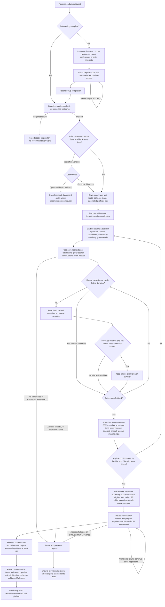

# Recommendation workflow

Broader Vids finds videos, checks their content, and learns from explicit feedback.
This document explains the user workflow.
See the [terminal reference](REFERENCE.md) for commands.

## 1. Complete setup and check readiness

First-time setup introduces chat recommendations and the local dashboard.
Choose the included starter preset, enter interests manually, or import preferences.
The starter preset uses sanitized interests, model parameters, and uncertainty from the owner's export.
It contains no watched IDs, video history, topic coverage, or creator exclusions.
An import asks for the full local JSON file path.
For an existing profile, choose whether to keep or change its preferences.
Keep preserves the saved preferences and sources. It skips source selection.
Change lets you choose the starter preset, manual interests, or an import.
Then choose YouTube, Bilibili, or both as your sources.
The host shows question controls when available. A text-only host asks the same questions in chat.
Setup waits for each submitted answer before dependent work.
After opening Bilibili sign-in, setup asks whether you signed in, need help, or are still signing in.
Required tools and selected platform access must pass before setup completes.
Transcription and ffprobe remain optional.
Each later round checks readiness without repeating setup.
Bilibili rounds check the saved browser session.
Required failures block new work and provide repair instructions.
Blacklist-sync failures retain the existing saved-copy policy.

After the final self-check, setup shows a standard message with four actions: Dashboard, Recommendations, Reset, and Clean.
The runtime renders this guide directly. The setup skill includes the complete guide in its response.
Each action includes its purpose, an example chat request, and its skill command.
The setup response must include this message, even if setup already introduced the features.
The Preferences page combines broader interests with import and export for learned preferences.
Open Preferences to edit the current broader interests shared by YouTube and Bilibili.
The editor shows saved interests before you choose any import file.
Interest changes preserve calibration and history.
Finish active recommendation work before saving, then start a new round.
Reset keeps tools and Bilibili sign-in while removing learned data and histories.
Clean removes the complete managed data directory while keeping the plugin installed.
Both destructive actions start with a preview and require an explicit request before application.

Before a new round, the engine counts incomplete feedback across earlier recommendations for the requested platforms.
It counts each canonical video once and excludes dismissed videos and calibration-only examples.
Any blank topic, subject, depth, or quality rating makes a video incomplete.
Watched status does not change this count.
The report separates unrated videos from partially rated videos.
Choose **Open dashboard and stop** or **Continue this round**.
The dashboard choice ends the request until you invoke recommendations again.
Continuing leaves blank ratings unchanged and permits only this new round.
Resumed rounds check readiness without repeating the feedback prompt.
Automated preflight remains limited to thirty seconds.
Its time counts toward an optional total allowance when you explicitly set one.
Manual setup, user decisions, and repairs occur outside that allowance.

### Set your interests

Choose broad subjects that you enjoy.
Examples include mathematics, physics, travel, food, games, and music.
Broader Vids stores these choices in your local profile.
Production recommendations start from these interests and learn from normal feedback.
The installed setup skill records your chosen local profile directory.
It preserves an existing profile when you choose to keep its preferences.
To start fresh from an existing profile, use Reset and complete its preview and confirmation.
Then restart setup.
A separate calibration list is optional.
Search activity does not add a preference automatically.

Use the separate Bilibili browser window to sign in.
Public searches use a separate anonymous session.
Full-video evidence can require the saved sign-in.

## 2. Explore familiar and new topics

Broader Vids keeps a hierarchy of topics.
For example, mathematics can contain algebra, which can contain algebraic geometry.
The hierarchy describes search coverage.
It does not prove that you like every child topic.

Each new recommendation round targets twelve existing leaf topics and five new topics.
The program selects existing topics before AI query writing.
It favors underused branches and familiar topics.
When alternatives exist, it skips narrow topics that appeared in recommendations during the last three rounds.
Both platforms in one recommendation batch share topic reservations.
The engine records when it relaxes a reservation or cooldown because it finds few alternatives.
On a cold start, the AI can first propose subdivisions for selected topics.
The AI then writes paired queries for selected concepts: English for YouTube and Simplified Chinese for Bilibili.
The plan uses at most two calls for subdivision and query writing.
The language rule changes search text, not interest labels or hierarchy levels.
Existing topic labels and aliases stay stable as the hierarchy grows.
The engine converts Traditional Chinese keywords to Simplified Chinese and rejects incompatible scripts before a keyword search.
Creator lookups keep the observed creator name. They do not translate it.
Removed onboarding interests and their unrelated child branches leave automatic selection.
Their map records remain available if you add the interest again.
Query planning favors different concrete subtopics from recent searches and includes content beyond theory and tutorials.
The model proposes new subjects or narrower branches when useful.
The engine checks search results before it activates a proposed topic.
A small initial hierarchy can produce fewer than twelve existing topics.
If the first ten results have no title-anchor match, the engine can retry once with the shortest bilingual fallback for the same concept.
This retry uses no extra AI call.

YouTube discovery uses keyword searches and creator video lists.
Bilibili discovery adds anonymous Home recommendations.
Queries include narrower subjects and subject intersections.
Discovery does not provide a uniform sample of either platform.

## 3. Screen candidates

Each platform keeps collecting and rejecting candidates until 100 pass metadata screening.
The engine retrieves counts, descriptions, tags, and playable-part duration information.
The following bounds apply before a video enters the eligible buffer.

| Admission check | YouTube | Bilibili |
| --- | --- | --- |
| Verified playable duration | Greater than 60 seconds and at most 90 minutes | Same, for the selected part |
| Views | At least 100 | At least 100 |
| Likes | At least 3 | At least 3 |
| Likes/views | At least 1% | At least 1% |
| Coins/views | Not required | At least 0.1% |
| Favorites/views | Not required | At least 0.2% |

These checks use raw counts and ratios before community-response smoothing.
Missing, negative, or nonfinite required counts fail admission.
An unknown or unresolved playable duration also fails admission.

The diagram shows the current path for each platform in a new recommendation round.
The two-platform command runs these paths with shared workers and an optional total time allowance.

Known exclusions include watched or dismissed videos, excluded creators, and excluded metadata tags.
The engine repeats these checks after metadata retrieval, which can reveal an excluded creator or tag.
It rejects a known short video before a detailed metadata request.
Bilibili listings with ambiguous duration require resolution of the selected part first.
Duplicate videos do not increase the eligible count.
When the candidate pool ends, collection tries saved search continuations within the remaining limits.
Metadata workers retain server-issued cookies across requests within a collection attempt.
YouTube search refills reuse that visitor session and its request gate.
Bilibili discovery refills use a separate anonymous session. They do not receive authenticated metadata cookies.
YouTube metadata uses one active watch-page request and spaces starts by at least one second.
Bilibili permits two concurrent metadata requests and spaces starts by at least one second.
Workers use separate database connections and a shared request gate.
Pacing waits count toward an optional total time allowance.
They do not change request limits or per-operation timeouts.
Worker cookies do not appear in reports or model inputs.
An incomplete YouTube player response can receive one retry through the same request path.
Both attempts consume the existing time and request allowances.
Identity mismatches and explicit sign-in or access denials pause the route without an automatic retry.
A YouTube sign-in pause includes the video link and manual access-review instructions.
Normal browser sign-in is not imported automatically.
A larger request cap does not resolve a verification challenge.
A failed validation records the requested video ID, returned video ID, and available player status with its request receipt.

The collector scans batches of up to 100 unique candidates.
It targets 71 familiar and 29 exploratory eligible videos, which rounds the 12:5 split to 100 slots.
A familiar retrieval origin names a saved broader interest and does not mark the topic as new.
New topics, anonymous Home results without a familiar origin, and unclassified sources count as exploratory.
A video with a qualifying familiar origin counts once in the familiar group.
These source labels do not establish a preference or prove the video's topic.
Each completed batch contributes its highest screening scores only to missing slots in the corresponding group.
Later batches allocate more raw candidates to the group with the larger deficit.
Rejected exploratory candidates cannot create extra familiar slots.
Use existing discovered candidates before requesting more pages.
When a group lacks candidates, continue its saved search queries.
Repeated pages or continuation cursors stop that query instead of repeating its videos.
A source-exhausted batch can contain fewer than 100 raw candidates.
An unfinished batch keeps its index and eligible survivors for continuation.
The collector keeps a bounded summary for completed batches.
It releases their active batch data.

Screening policy 5 combines 80% of the metadata screening score with 20% learned interest.
The metadata score keeps its 70% community-response and 30% title-anchor weights.
The interest estimate uses a specific topic when verified titles or tags name it.
Otherwise, it uses a broad-subject estimate when available.
Unknown context receives a neutral value of 50.
Screening uses verified video context and does not infer quality.
Use depth only when the engine verifies the video level.
Screening policy 5 selects thirty-five videos while balancing search-query coverage.
Screening policy 4 also balances query coverage across thirty-five inspection slots.
At each slot, the engine favors queries with fewer selected videos, then the higher applicable screening score.
All retrieval origins count when a video appears under several queries.
When only a few queries supply candidates, repeat queries fill the remaining inspection slots.
The engine calls no content-quality assessment model during screening.
Topic planning can use AI earlier, during discovery.
One frozen learning-model reference supports screening. The engine keeps that reference through continuation, preview, and final selection.
Feedback saved during a round affects later rounds.
Equal screening scores use canonical video IDs as the tie-breaker.
Pending recommendations compete using the same screening rules without guaranteed slots.
Collection continues through saved searches within request limits, any explicit time allowance, and a 4,000-candidate safety limit.
If either eligible group remains short at a limit or source exhaustion, the run remains incomplete and quality assessment does not start.
The default metadata allowance is 320 requests per platform, including blacklist sync and search refills.
This is a request cap, not a candidate count or a guarantee of 100 accepted videos.
An explicit continuation can increase the saved request cap up to 1,000.
It preserves prior request use, elapsed time, rules, model settings, completed results, and collection progress.

By default, the exact Bilibili tag `视频翻译` excludes a video during admission and final selection.
Other translation disclosures inform the later originality assessment.
A missing or inaccessible response does not count as a poor-quality video.

Quality evidence can leave a video's quality unknown, which excludes that video from final selection.
A candidate failure does not cancel unrelated inspections.
Validation failures share the same three-retry limit and saved call and image allowances.
Access challenges pause the affected platform.
Missing model authentication or provider limits stop shared model work.
Final selection first favors candidates that avoid overlap with earlier picks in the same platform list.
Overlap uses shared search queries, matching primary content topics, and secondary-school course markers.
Broad subjects alone do not create overlap.
If no remaining candidate avoids overlap, the engine chooses the least overlapping candidate, then the highest score.
Score details identify these relaxed selections.
This rule adds no model calls and changes no learned score weights.
Normal publication follows the assessment stage and can contain fewer than ten eligible videos.
Publishing an assessed subset before that stage finishes requires an explicit request for provisional publication.
Paused rounds show a provisional preview in chat and the dashboard when verified assessments exist.
The dashboard labels this list and accepts feedback with its saved assessment context.
The preview adds no recommendation history or pending entries.

## 4. Check content quality

Broader Vids checks one playable video or Bilibili part at a time.
It excludes durations of sixty seconds or less and above ninety minutes, including when evidence reveals a different listing duration.
Longer videos receive a small initial benefit up to one hour.
The benefit does not increase after one hour.

The engine prefers original caption tracks.
For YouTube, it requests original English or Chinese tracks before other original languages.
It skips automatic translation endpoints, which can return HTTP 429 even when original captions work.
The AI can assess original captions in other languages.
A creator may provide no separate caption track.
Caption availability does not establish whether the video contains narration.
Optional local transcription supplies text when captions are unavailable.
If no usable transcript exists, the video still receives a visual assessment using frames and readable burned-in text, with a separate ten-point quality deduction.
Unsupported speech, sound and continuity properties remain unknown.
Caption access challenges pause acquisition for the affected platform instead of triggering visual fallback.
Prepared assessments finish before the engine saves this pause.
A continuation retains completed assessments and remaining allowances.
The initial assessment uses up to four distinct frames when captions are available.
Without captions, new evidence jobs sample up to eight distinct frames across the video.
Frame deduplication can reduce the actual count.
A continuation keeps its saved sampling policy.
The model assesses substance, directness, original contribution, and useful visuals using captions together with frames.
The model judges content against the video's purpose.
For travel films, concrete visual coverage can support substance without an instructional explanation.
Directness describes the relevance and focus of the samples.
It does not certify pacing or continuity throughout unseen sections.
A performance or visual demonstration does not need to be a lesson.
The model does not assess audio quality.
Silent frames cannot establish musical performance quality or missing speech.
A null quality score means that the assessment lacks support.
It does not mean that the download failed or the video has poor quality.
The caption deduction is a separate adjustment.
Unsupported properties remain unknown.

The engine prefers small video streams for analysis.
It requests audio only when optional transcription needs it.
It limits the short image edge to 720 pixels.
Both platforms allow an initial attempt and up to three retries for recoverable video access or candidate processing exceptions.
Retries share the saved resource limits. Stricter model and image limits can stop retries earlier.
Exhausted exceptions skip the video and do not block other candidates.
The engine resumes partial files and uses offered CDN routes in the platform's order.
It does not prioritize one CDN provider.
Retries cycle through the offered routes and preserve a transfer that can finish within its allowance.
An exhausted candidate download becomes unavailable. Other assessments continue.
The final response reports candidate failures and recovered downloads after all requested recommendation lists.
The report separates download status from assessment status and records the reason for each skip.
A successful download stops immediately, even when later assessment cannot produce a score.
The engine does not download the same completed video again to repeat an unsupported judgment.
Access challenges and shared run limits still pause work.
After a checked assessment, it removes the downloaded full video.
It retains the smaller evidence needed for later reuse.

## 5. Rank and review recommendations

A complete run selects ten YouTube videos and ten Bilibili videos.
The ranking combines quality, interest, community response, recency, and creator diversity.
Feedback can change the learned ranking.
The [scoring document](SCORING.md) explains the formulas and limits.

The engine selects the final ten by the full recommendation score after quality assessment.
It applies no unrelated-topic quota.
Unwatched recommendations can appear again.
Their history remains saved even when they are outside the current list.

Read the linked digest or open the local dashboard.
Check any access failures and incomplete assessments.
The default batch has no overall time limit.
Individual operations retain timeouts. Request, media, and model-call limits still apply.
It can retain unfinished work instead of producing twenty complete recommendations.

## 6. Give separate feedback

| Control | Meaning |
| --- | --- |
| Specific topic | Your interest in the named narrow subject |
| Broader subject | Your interest in the named larger domain |
| Depth for this video | Whether you want deeper, similar, or lighter treatment |
| Video quality | Your assessment of this video's quality |
| Watched | You watched this video |
| Dismiss | Remove this video from future recommendation lists |

Topic, subject, and quality ratings accept High, Medium, and Low.
Medium interest means indifference.
Medium quality means acceptable quality.
Not rated yet identifies an empty field.
It does not create a rating.
Use Clear to remove a saved judgment.
Check the topic label before you save feedback.

Use **Too basic** when you prefer the subject but need more depth.
Use a specific-topic dislike when you dislike that topic within a broader subject you enjoy.
These judgments do not create a broader-subject dislike.
Depth feedback does not reduce the video's quality rating.

Opening a link does not mark it watched.
Leaving a recommendation unwatched does not create a negative rating.
You can edit or clear each feedback dimension independently.
AI topics describe the video content rather than its search query.
The AI also estimates the video level from its prerequisites.
Check these labels before saving feedback.

Select Rate beside a video to open its review panel.
Use each rating group's Save control to store its judgment.
Use Previous and Next to review consecutive videos.
The list keeps its position while you edit ratings or inspect score details.
On a narrow screen, use Back to return to the list.
Help explains the rating labels and video actions.
Creator and tag exclusions remain separate rules.
Each video's feedback panel includes a creator checkbox.
It saves immediately but applies to the next new round.
The current recommendation list remains visible.
An unknown creator ID disables this control.
Unknown creators remain eligible for recommendation.
The dashboard order is Recommendations, Exclusions, then Calibration.
The exclusion panel lists creators and tags separately for each platform.
Use its Add tag form to exclude an exact metadata tag on that platform.
It identifies manual rules, imported Bilibili bans, and built-in rules.
Remove manual rules there when needed.
The built-in 视频翻译 tag has a Remove button. Add the tag again to restore that exclusion.
Tag removals remain saved after a restart or preference import.
Unblock imported creators on Bilibili, then sync the blacklist.

Bilibili sign-in and each new Bilibili round attempt a complete blacklist sync.
The dashboard also provides Sync blacklist.
Failed imports retain the account's last complete copy and show a notice.
A new account uses its own imported list, plus your manual rules.
A resumed round retains its original creator rules.
New rounds release pending slots for excluded creators without changing their ratings or watched state.

## 7. Use optional calibration

Calibration provides extra examples and compares predictions with your separate interest and quality judgments.
You can use ordinary recommendations without completing this list first.
Fresh profiles have an empty calibration view.
Opening the view does not add examples.
The current terminal calibration command reserves thirty previously unrated videos across both platforms.
Some reserved videos test predictions before their labels enter training.
This separation limits feedback leakage into the test result.

Rate only the dimensions that you can judge.
The workflow accepts missing judgments.
It does not require a false rating to fill a quota.
New response types require their own test coverage.

## 8. Continue or request another round

Continue an incomplete batch with its printed batch ID.
Continuation retains the original topic plan and remaining allowances.
Request another recommendation run when you want a new round with a new allowance.
Both actions use the same saved profile and pending queue.

Recommendation rounds run only when you request them.

## 9. Transfer learned preferences

Open **Preferences** in the dashboard.
Broader interests and import/export share one page.
After import, edit the imported interests in place and select Save if needed.
Save interest edits before exporting.
Export saves your interests, learned weights, parameter uncertainty, watched video IDs, a bounded topic-coverage summary, and manual creator exclusions.
Import previews a format 4 file before replacing those parameters.
Broader Vids saves the earlier parameters in a local recovery file first.

Import marks matching IDs as watched to prevent exact video repeats.
The coverage summary stores up to 1,024 hierarchy nodes, aggregate counts, and relative round ages.
It does not store individual video history.
Files contain no titles, individual feedback, calibration examples, or recommendation history.
Tag rules and account-specific blacklist copies stay local.
Preference import replaces the local manual creator lists.
An empty list clears manual rules.
Blacklist sync preserves all manual exclusions and combines them with the verified account's imported blacklist.
Your dashboard lists, ratings, watch states, tag rules, and account-specific blacklist copies stay in this profile.
Import adds watched status for IDs in the file without clearing local states.
Imported parameters supply the starting distribution for future learning.
New and edited ratings update that distribution.
Pre-import local ratings remain visible but do not train the model again.
See the [terminal reference](REFERENCE.md#export-or-import-learned-preferences) for commands and recovery steps.

## Inspect token usage

Open Token usage in the dashboard and select a recommendation round.
The report is available during a run and after completion, pause, or failure.
It separates topic exploration, search and screening, evidence preparation, quality assessment, and final scoring.
Stage percentages use reported input plus output tokens.
Cached input is part of input and is not added again.
Local steps show no model tokens.
Failed or interrupted attempts without measurements remain unreported.
The report does not include the host chat or estimate subscription quota.
