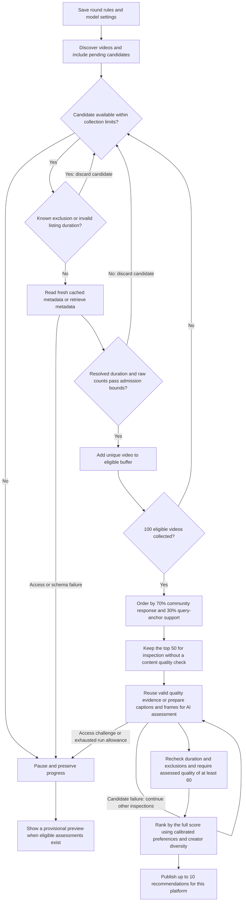

# Recommendation workflow

Broader Vids finds videos, checks their content, and learns from explicit feedback.
This document explains the user workflow.
See the [terminal reference](REFERENCE.md) for commands.

## 1. Set your interests

Choose broad subjects that you enjoy.
Examples include mathematics, physics, travel, food, games, and music.
Broader Vids stores these choices in your local profile.
Production recommendations start from these interests and learn from normal feedback.
The installed setup skill records your chosen local profile directory.
It preserves an existing calibrated profile when you select that directory.
Development pilot checks do not block a fresh profile's first recommendation round.
A separate calibration list is optional.
Search activity does not add a preference automatically.

Use the separate Bilibili browser window to sign in.
Public searches use a separate anonymous session.
Full-video evidence can require the saved sign-in.

## 2. Explore familiar and new topics

Broader Vids keeps a hierarchy of topics.
For example, mathematics can contain algebra, which can contain algebraic geometry.
The hierarchy describes search coverage.
It does not prove that you like every child topic.

Each new discovery round targets twelve existing topics and five proposed topics.
Weighted random selection favors familiar topics and topics with less search history.
The model proposes new subjects or narrower branches when useful.
The engine checks search results before it activates a proposed topic.
A small initial hierarchy can produce fewer than twelve existing topics.

YouTube discovery uses keyword searches and creator video lists.
Bilibili discovery adds anonymous Home recommendations.
Queries include narrower subjects and subject intersections.
Discovery does not provide a uniform sample of either platform.

## 3. Screen candidates

Each platform keeps collecting and rejecting candidates until 100 pass metadata screening.
The engine retrieves counts, descriptions, tags, and playable-part duration information.
The following bounds apply before a video enters the eligible buffer.

| Admission check | YouTube | Bilibili |
| --- | --- | --- |
| Verified playable duration | Greater than 60 seconds and at most 90 minutes | Same, for the selected part |
| Views | At least 100 | At least 100 |
| Likes | At least 3 | At least 3 |
| Likes/views | At least 1% | At least 1% |
| Coins/views | Not required | At least 0.1% |
| Favorites/views | Not required | At least 0.2% |

These checks use raw counts and ratios before community-response smoothing.
Missing, negative, or nonfinite required counts fail admission.
An unknown or unresolved playable duration also fails admission.

The diagram shows the current path for each platform in a new recommendation round.
The two-platform command runs these paths with shared workers and one time allowance.
Continuing an older round retains its saved screening policy, including any reserved pending slots and topic quotas.

Known exclusions include watched or dismissed videos, excluded creators, and excluded metadata tags.
The engine repeats these checks after metadata retrieval, which can reveal an excluded creator or tag.
It rejects a known short video before a detailed metadata request.
Bilibili listings with ambiguous duration require resolution of the selected part first.
Duplicate videos do not increase the eligible count.
When the candidate pool ends, collection tries saved search continuations within the remaining limits.
Metadata retrieval allows two concurrent requests with separate database connections.
Request starts remain at least one second apart and share the platform's request allowance.

The engine selects the global top fifty from those 100 using community response and query relevance.
The engine calls no content quality model during this screening.
Topic planning can use AI earlier, during discovery.
Equal screening scores use canonical video IDs as the tie-breaker.
Pending recommendations compete using the same rules without guaranteed slots or topic quotas.
Collection continues through saved search continuations within request and time allowances and a 4,000-candidate safety limit.
If fewer than 100 pass before a limit or source exhaustion, the run remains incomplete and quality assessment does not start.

The exact Bilibili tag `视频翻译` excludes a video during admission and final selection.
Other translation disclosures inform the later originality assessment.
A missing or inaccessible response does not count as a poor-quality video.

Quality evidence can leave a video's quality unknown, which excludes that video from final selection.
A candidate failure does not cancel unrelated inspections.
Validation failures can receive one repair attempt within the saved call and image allowances.
Access challenges pause the affected platform.
Missing model authentication or provider limits stop shared model work.
Normal publication follows the assessment stage and can contain fewer than ten eligible videos.
Publishing an assessed subset before that stage finishes requires an explicit request for provisional publication.
Paused rounds show a provisional preview when verified assessments exist.
The preview adds no recommendation history or pending entries.

## 4. Check content quality

Broader Vids checks one playable video or Bilibili part at a time.
It excludes durations of sixty seconds or less and above ninety minutes, including when evidence reveals a different listing duration.
Longer videos receive a small initial benefit up to one hour.
The benefit does not increase after one hour.

The engine prefers native captions.
Optional local transcription supplies text when captions are unavailable.
If no usable transcript exists, the video still receives a visual assessment using frames and readable burned-in text, with a separate ten-point quality deduction.
Unsupported speech, sound and continuity properties remain unknown.
Caption access challenges pause the affected platform instead of triggering visual fallback.
The initial assessment uses available captions and up to four distinct selected frames.
The model assesses substance, directness, original contribution, and useful visuals using captions together with frames.
The model does not assess audio quality.
The caption deduction is a separate adjustment.
Unsupported properties remain unknown.

The engine prefers small video streams for analysis.
It requests audio only when optional transcription needs it.
It limits the short image edge to 720 pixels.
After a checked assessment, it removes the downloaded full video.
It retains the smaller evidence needed for later reuse.

## 5. Rank and review recommendations

A complete run selects ten YouTube videos and ten Bilibili videos.
The ranking combines quality, interest, community response, recency, and creator diversity.
Feedback can change the learned ranking.
The [scoring document](SCORING.md) explains the formulas and limits.

The engine selects the final ten by the full recommendation score after quality assessment.
It applies no unrelated-topic quota.
Unwatched recommendations can appear again.
Their history remains saved even when they are outside the current list.

Read the linked digest or open the local dashboard.
Check any access failures and incomplete assessments.
The default batch stops within its thirty-minute allowance.
It can retain unfinished work instead of producing twenty complete recommendations.

## 6. Give separate feedback

| Control | Meaning |
| --- | --- |
| Specific topic | Your interest in the named narrow subject |
| Broader subject | Your interest in the named larger domain |
| Depth for this video | Whether you want deeper, similar, or lighter treatment |
| Video quality | Your assessment of this video's quality |
| Watched | You watched this video |
| Dismiss | Remove this video from future recommendation lists |

Topic, subject, and quality ratings accept High, Medium, and Low.
Medium interest means indifference.
Medium quality means acceptable quality.
Not rated yet identifies an empty field.
It does not create a rating.
Use Clear to remove a saved judgment.
Check the topic label before you save feedback.

Use **Too basic** when you prefer the subject but need more depth.
Use a specific-topic dislike when you dislike that topic within a broader subject you enjoy.
These judgments do not create a broader-subject dislike.
Depth feedback does not reduce the video's quality rating.

Opening a link does not mark it watched.
Leaving a recommendation unwatched does not create a negative rating.
You can edit or clear each feedback dimension independently.
AI topics describe the video content rather than its search query.
The AI also estimates the video level from its prerequisites.
Check these labels before saving feedback.

Select Rate beside a video to open its review panel.
Use each rating group's Save control to store its judgment.
Use Previous and Next to review consecutive videos.
The list keeps its position while you edit ratings or inspect score details.
On a narrow screen, use Back to return to the list.
Help explains the rating labels and video actions.
Creator and tag exclusions remain separate rules.
Each video's feedback panel includes a creator checkbox.
It saves immediately but applies to the next new round.
The current recommendation list remains visible.
An unknown creator ID disables this control.
Unknown creators remain eligible for recommendation.
The dashboard order is Recommendations, Exclusions, then Calibration.
The exclusion panel lists creators and tags separately for each platform.
Use its Add tag form to exclude an exact metadata tag on that platform.
It identifies manual rules, imported Bilibili bans, and built-in rules.
Remove manual rules there when needed.
Unblock imported creators on Bilibili, then sync the blacklist.

Bilibili sign-in and each new Bilibili round attempt a complete blacklist sync.
The dashboard also provides Sync blacklist.
Failed imports retain the account's last complete copy and show a notice.
A new account uses its own imported list, plus your manual rules.
A resumed round retains its original creator rules.
New rounds release pending slots for excluded creators without changing their ratings or watched state.

## 7. Use optional calibration

Calibration provides extra examples and compares predictions with your separate interest and quality judgments.
You can use ordinary recommendations without completing this list first.
Fresh profiles have an empty calibration view.
Opening the view does not add examples.
The current terminal calibration command reserves thirty previously unrated videos across both platforms.
Some reserved videos test predictions before their labels enter training.
This separation limits feedback leakage into the test result.

Rate only the dimensions that you can judge.
The workflow accepts missing judgments.
It does not require a false rating to fill a quota.
New response types require their own test coverage.

## 8. Continue or request another round

Continue an incomplete batch with its printed batch ID.
Continuation retains the original topic plan and remaining allowances.
Request another recommendation run when you want a new round with a new allowance.
Both actions use the same saved profile and pending queue.

Automatic daily triggers remain planned.
The intended daily workflow runs locally through a desktop scheduled task.
It will preserve pending videos and feedback between dates.
The local computer and desktop app must run for that schedule to execute.

## 9. Transfer learned preferences

Open **Import/Export** in the dashboard.
Export saves your interests, learned weights, and parameter uncertainty.
Import previews a compatible file before replacing those parameters.
Broader Vids saves the earlier parameters in a local recovery file first.

Files contain no calibration examples, individual feedback, recommendation history, or exclusions.
Your current dashboard lists and history remain local and unchanged.
Imported parameters supply the starting distribution for future learning.
New and edited ratings update that distribution.
Pre-import local ratings remain visible but do not train the model again.
See the [terminal reference](REFERENCE.md#export-or-import-learned-preferences) for commands and recovery steps.
